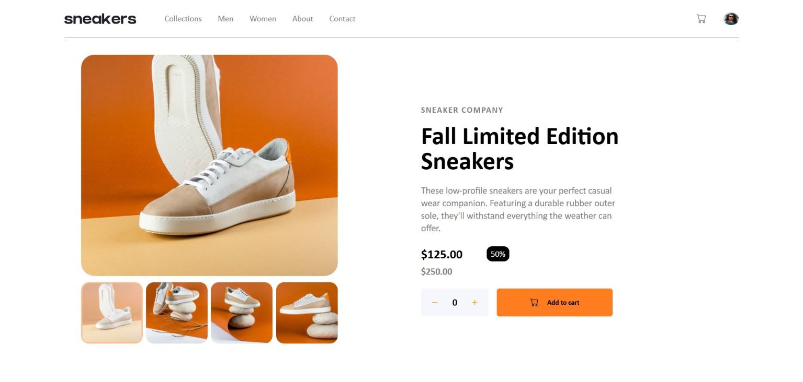
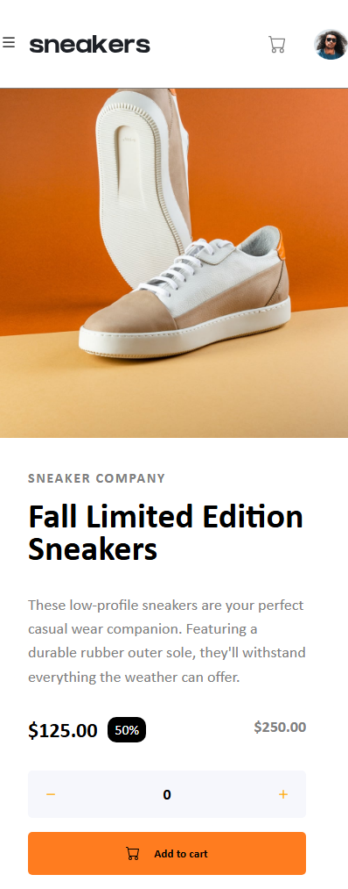

# E-commerce Product Page

A responsive e-commerce product page built with HTML & CSS — Fall Limited Edition Sneakers.

Practice project.

## Preview

### PC

### Mobile

## About

I built a complete e-commerce product page for the Sneaker Company, in two versions: PC and mobile. On PC the page shows a photo gallery on the left and the product details on the right; on mobile everything stacks vertically and the navigation becomes a slide-in menu. This repo holds the screenshots of both versions.

## What I built in this project

- **Header:** the "sneakers" logo, a navigation bar (Collections, Men, Women, About, Contact), a cart icon and a user avatar, separated from the page by a thin bottom border.
- **Product gallery:** a large product photo with rounded corners, and 4 thumbnails below it. The selected thumbnail is highlighted with an orange border and a faded opacity, so you can see which photo is active.
- **Product info:** the brand name "SNEAKER COMPANY" in uppercase, the title "Fall Limited Edition Sneakers", and a description of the shoes.
- **Price:** $125.00 with a black 50% discount badge, and the old price $250.00 crossed out below it. On mobile the price row becomes horizontal, with the old price on the right.
- **Quantity selector:** a grey box with a minus button, the quantity (0) and a plus button.
- **Add to cart button:** an orange button with a cart icon.
- **Mobile menu without JavaScript:** on small screens the navigation hides behind a hamburger icon. Clicking it opens a slide-in panel from the left with the links in a column and a close button — done with a hidden checkbox and CSS only.
- **Responsive layout:** on mobile the thumbnails hide, the main photo loses its rounded corners and goes full width, and the quantity selector and Add to cart button stretch to the full width, one under the other.

## What I learned

- **A menu without JavaScript:** a hidden checkbox + a label + the `:checked` selector can open and close a mobile menu with CSS only.
- **Responsive with a media query:** `@media (max-width: 440px)` stacks the page vertically, hides the thumbnails, and changes the price row to a horizontal layout.
- **Slide-in panel:** `position: absolute` with `left: -100%` hides the menu off-screen, and `left: 0` with a `transition` slides it in smoothly.
- **Highlighting the selected thumbnail:** `opacity` + a coloured `border` shows which photo is active.
- **Flexbox for the whole page:** header, gallery, price and buttons are all laid out with flex.

## Tech

- HTML
- CSS (Flexbox, media query)

## How to open

Open index.html in your browser.
